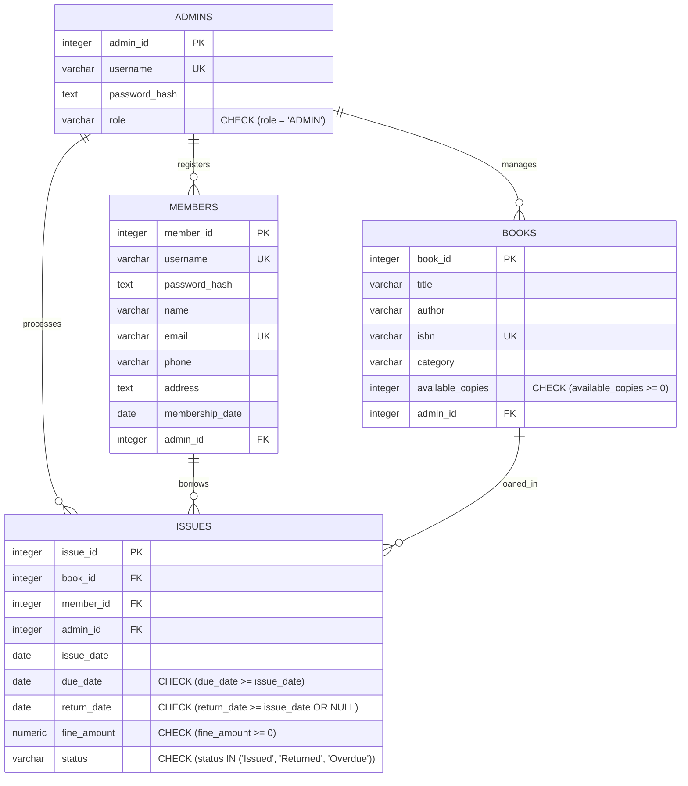

# Technical Reference: Schema, Circulation, and Fine Calculations

This document details the database architecture, transactional inventory workflows, overdue status synchronization, fine calculation logic, and automated testing architecture of the Library Management System.

---

## 1. Database Schema & Relational Structure

The database schema is defined in `database/schema.sql` for PostgreSQL (hosted on Supabase).

### Entity Relationship Diagram (ERD)



### Table Definitions & Constraints

1. **`admins`**:
   - `admin_id` (`GENERATED ALWAYS AS IDENTITY PRIMARY KEY`): Unique internal identifier.
   - `username` (`VARCHAR(50) NOT NULL UNIQUE`): Unique admin login name.
   - `password_hash` (`TEXT NOT NULL`): Securely hashed password.
   - `role` (`VARCHAR(20) NOT NULL DEFAULT 'ADMIN'`): Enforces `role = 'ADMIN'`.

2. **`members`**:
   - `member_id` (`IDENTITY PRIMARY KEY`): Unique member identifier.
   - `username` (`VARCHAR(50) NOT NULL UNIQUE`): Unique member login name.
   - `password_hash` (`TEXT NOT NULL`): Bcrypt password hash (12 salt rounds).
   - `name` (`VARCHAR(100) NOT NULL`): Full name.
   - `email` (`VARCHAR(150) NOT NULL UNIQUE`): Member email.
   - `phone` (`VARCHAR(15)`): Optional telephone number.
   - `address` (`TEXT`): Optional residential/postal address.
   - `membership_date` (`DATE NOT NULL DEFAULT CURRENT_DATE`): Date membership started.
   - `admin_id` (`FK` -> `admins(admin_id) ON UPDATE CASCADE ON DELETE RESTRICT`): Admin who registered the member.

3. **`books`**:
   - `book_id` (`IDENTITY PRIMARY KEY`): Unique book identifier.
   - `title` (`VARCHAR(200) NOT NULL`): Title of the work.
   - `author` (`VARCHAR(150) NOT NULL`): Author(s).
   - `isbn` (`VARCHAR(20) NOT NULL UNIQUE`): Unique ISBN identifier.
   - `category` (`VARCHAR(100) NOT NULL`): Genre/subject category.
   - `available_copies` (`INTEGER NOT NULL DEFAULT 0`): Real-time stock on shelf. Constrained by `CHECK (available_copies >= 0)`.
   - `admin_id` (`FK` -> `admins(admin_id) ON UPDATE CASCADE ON DELETE RESTRICT`): Admin who cataloged the book.

4. **`issues`**:
   - `issue_id` (`IDENTITY PRIMARY KEY`): Unique circulation record ID.
   - `book_id` (`FK` -> `books(book_id) ON UPDATE CASCADE ON DELETE RESTRICT`).
   - `member_id` (`FK` -> `members(member_id) ON UPDATE CASCADE ON DELETE RESTRICT`).
   - `admin_id` (`FK` -> `admins(admin_id) ON UPDATE CASCADE ON DELETE RESTRICT`).
   - `issue_date` (`DATE NOT NULL DEFAULT CURRENT_DATE`).
   - `due_date` (`DATE NOT NULL`, `CHECK (due_date >= issue_date)`).
   - `return_date` (`DATE NULL`, `CHECK (return_date IS NULL OR return_date >= issue_date)`).
   - `fine_amount` (`NUMERIC(10,2) NOT NULL DEFAULT 0.00`, `CHECK (fine_amount >= 0)`).
   - `status` (`VARCHAR(20) NOT NULL DEFAULT 'Issued'`, `CHECK (status IN ('Issued', 'Returned', 'Overdue'))`).

---

## 2. Circulation Lifecycle & Concurrency Control

All circulation state mutations execute inside explicit PostgreSQL transactions with row-level locking (`FOR UPDATE`) to prevent race conditions and inventory corruption.

### Book Issue Workflow (`IssueModel.createIssue`)
1. **Transaction Begin:** `BEGIN`
2. **Member Check:** Verifies member exists in `members`.
3. **Pessimistic Lock & Stock Verification:**
   ```sql
   SELECT available_copies FROM books WHERE book_id = $1 FOR UPDATE
   ```
   If `available_copies <= 0`, aborts with `BOOK_UNAVAILABLE`.
4. **Issue Insertion:**
   ```sql
   INSERT INTO issues (book_id, member_id, admin_id, issue_date, due_date, status)
   VALUES ($1, $2, $3, $4, $5, 'Issued')
   RETURNING *
   ```
5. **Inventory Decrement:**
   ```sql
   UPDATE books SET available_copies = available_copies - 1 WHERE book_id = $1
   ```
6. **Transaction Commit:** `COMMIT`

### Book Return Workflow (`IssueModel.returnIssue`)
1. **Transaction Begin:** `BEGIN`
2. **Pessimistic Lock & Idempotency Check:**
   ```sql
   SELECT book_id, due_date, return_date, status FROM issues WHERE issue_id = $1 FOR UPDATE
   ```
   If `return_date IS NOT NULL` or `status = 'Returned'`, aborts with `ALREADY_RETURNED` to prevent double-restocking.
3. **Book Lock:**
   ```sql
   SELECT book_id FROM books WHERE book_id = $1 FOR UPDATE
   ```
4. **Fine Calculation & Issue Finalization:**
   - Normalizes return date using `getLocalDateString()`.
   - Computes fine: `calculateFine(issue.due_date, returnDate)`.
   - Updates issue record:
     ```sql
     UPDATE issues SET return_date = $1, status = 'Returned', fine_amount = $2 WHERE issue_id = $3
     ```
5. **Inventory Increment:**
   ```sql
   UPDATE books SET available_copies = available_copies + 1 WHERE book_id = $1
   ```
6. **Transaction Commit:** `COMMIT`

---

## 3. Overdue Status Synchronization & Fine Calculation

### Overdue Status Synchronization (`IssueModel.syncOverdueStatuses`)
Before reading loan records or rendering dashboard metrics, the system synchronizes past-due loans:
```sql
UPDATE issues 
SET status = 'Overdue' 
WHERE status = 'Issued' 
  AND return_date IS NULL 
  AND due_date < CURRENT_DATE
```
- **Idempotent:** Safe to run frequently.
- **Protected:** Never modifies records where `status = 'Returned'` or `return_date IS NOT NULL`.

### Centralized Fine Policy (`IssueModel.calculateFine`)
```javascript
static calculateFine(dueDateInput, referenceDateInput) {
    const dueDate = new Date(dueDateInput);
    const refDate = new Date(referenceDateInput);
    
    dueDate.setHours(0, 0, 0, 0);
    refDate.setHours(0, 0, 0, 0);
    
    if (refDate <= dueDate) {
        return { lateDays: 0, fineAmount: 0 };
    }
    
    const lateDays = Math.round((refDate - dueDate) / (1000 * 60 * 60 * 24));
    return { lateDays, fineAmount: lateDays * 5 };
}
```

- **Policy Rules:**
  - Rate: **₹5 per day**.
  - Grace Period: **0 days**.
  - Cap: **None**.
  - Due Date: If returned on or before due date, `lateDays = 0` and `fineAmount = 0`.
- **Dynamic vs Settled Fines:**
  - **Overdue Loans (`status = 'Overdue'`):** `displayFine` is computed dynamically as `lateDays * 5` using the current date (`new Date()`).
  - **Returned Loans (`status = 'Returned'`):** `displayFine` is the immutable persisted value stored in `fine_amount`.

---

## 4. Test Coverage & Diagnostic Architecture

The automated test suite contains **116 unit tests** (`npm test`) across 16 categories, plus **20 HTTP integration tests** (`npm run test:http`) verifying multi-session isolation and end-to-end security over real loopback network sockets:

1. **Fine Calculation Tests (9 tests):**
   - On-time return, 1 day early, multi-day early.
   - 1 day late (₹5), 5 days late (₹25), 30 days late across months (₹150).
   - Past reference dates (non-negative assertion).
   - Boundary timestamp normalization (23:59:59 due date vs 00:00:01 next day).
2. **Local Calendar Date Handling (4 tests):**
   - YYYY-MM-DD parsing, single-digit month/day zero-padding, early morning hour preservation.
3. **Report Date-Range Validation (4 tests):**
   - `from_date <= to_date`, inversion rejection, same-day reports, default 30-day window.
4. **Database Connectivity Diagnostic (1 test):**
   - Live query handshake against PostgreSQL connection pool.
5. **EJS Template Compilation (8 tests):**
   - Verifies all Member templates and partials compile without syntax errors.
6. **Shared Component Functional & Accessibility Tests (23 tests):**
   - `page-header`: Title, description, breadcrumbs.
   - `status-badge`: Mapping of `Issued`, `Overdue`, `Returned`, `Available`, `Out of Stock`.
   - `pagination`: Single-page suppression, multi-page controls, query preservation.
   - `member-sidebar`: Clean URL navigation without testing parameter leakage.
   - `dashboard.ejs`, `books.ejs`, `issues.ejs`, `profile.ejs`: Rendering checks, empty states, zero inline styles.
7. **Member Portal Model Database & Validation Tests (29 tests):**
   - Model resolution, query filters, search substrings, availability filters, pagination clamping.
   - Profile validation (name, phone, address boundaries and immutable column protection).
8. **Authentication, Session, Authorization & Security Tests (38 tests):**
   - Password hashing with bcrypt (12 rounds) and comparison logic.
   - Session regeneration and cookie security flags (`httpOnly`, `sameSite`, `secure`).
   - Authentication UI accessibility and generic error handling.
   - Unauthenticated guest access restrictions (HTTP 401/302).
   - Role-based authorization (`requireAdmin`, `requireMember`, HTTP 403 enforcement).
   - Horizontal member ownership & identity isolation from authenticated session.
   - Cache-Control `no-store` headers and open-redirect defense.
   - Synchronizer CSRF token validation and query-string rejection (10 tests).
   - Login rate limiting, compound key anti-DoS, and `Retry-After` calculation (7 tests).
9. **Multi-Session HTTP Integration Tests (20 tests):**
   - Real socket HTTP requests verifying cross-role blocking, multi-member isolation, CSRF rejection, GET logout 405 Method Not Allowed, and rate limit throttling.
